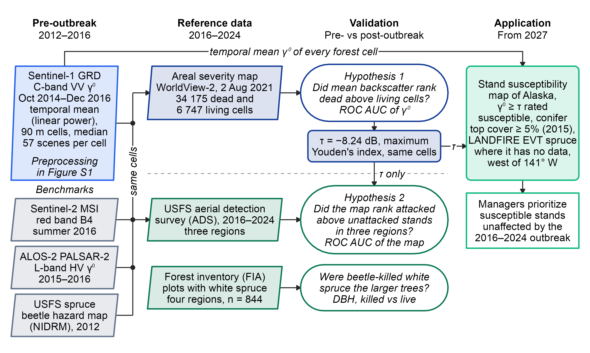

# A pre-outbreak map of spruce beetle susceptibility across Alaska from Sentinel-1 radar backscatter

## Abstract

In Alaska, outbreaks of the spruce beetle, *Dendroctonus rufipennis* (Kirby), killed the largest spruce first. Hazard ratings scored stands from field plots, a statewide hazard map was modelled from inventory plots and imagery, and remote sensing had mapped killed trees only after they died. This study mapped susceptible stands before the outbreak from Sentinel-1 radar backscatter of October 2014 to December 2016. Every scene over Alaska in that period formed one 90 m map, tested against the spruce killed in the Susitna valley by 2021 and the aerial detection survey. Before the outbreak, killed stands had returned more backscatter than surviving stands, -7.7 against -9.1 dB. On inventory plots in the Matanuska-Susitna Borough, the dead white spruce were taller than the live trees beside them, 14.6 against 10.4 m. The change in backscatter through the outbreak separated killed from surviving stands poorly, so the radar recorded stand structure before the attack, not mortality after it. At the threshold that best separated killed from surviving stands, producer’s accuracy, the share of a class classified correctly, was 88 and 78 per cent, respectively. Overall accuracy was 87 per cent. Against the survey, the map classified as susceptible 79 and 47 per cent of attacked and unattacked forest, respectively, on the Kenai Peninsula. In the Matanuska-Susitna Borough, the shares were 75 and 40 per cent. In the Interior, the shares were 30 and 19 per cent. The Copper River basin, which the survey had flown over in one or two of nine years, was set apart. The map classified 18 per cent of Alaska’s 446 963 km² of forest as susceptible stands to thin before the next outbreak.

## Figures

**Figure 1** The study area. Main map, Alaska in the Alaska Albers projection (EPSG:3338) over a shaded relief, with the spruce beetle damage mapped by the aerial detection survey from 2016 to 2024 in red, the three regions in which the statewide map was validated outlined in solid black and the Copper River basin, set apart, in dashed black, the validation strip of the Susitna valley in which Zwieback et al. (2024) mapped dead spruce crowns on a WorldView-2 image of 2 August 2021 framed in blue, and the two detail panels boxed. A, Cook Inlet, the Kenai Peninsula and the Susitna valley. B, the Interior along the Nenana River.

**Figure 2** Radar recorded before the outbreak was tested against mortality recorded after it, then mapped. Blue marks the radar, dark blue the strip that set the threshold τ, grey the benchmarks, dark green the tests and green the use. Only τ crossed from the strip to the regional test.

**Figure 3** Forest rated susceptible across Alaska, the share of each 1 km cell’s forest whose pre-outbreak mean VV backscatter reached the strip threshold of -8.24 dB. The share runs from grey for none to dark blue for all. Land with less than a fifth of its area in forest is pale grey, and southeast Alaska without conifer data, left unmapped, is darker grey. Solid black outlines are the three test regions, the dashed outline the Copper River basin set apart, and the black frame the validation strip.

**Figure S1.** Processing chain of each Sentinel-1 GRD scene, in the order applied, from the orbit file to the temporal mean backscatter.

## Tables

**Table 1.** The measures the study entered, the attribute of the hazard ratings each stands for, the direction expected in the stands an outbreak killed, and the literature the expectation rests on.

| Measure | Indicator | Assumption | Basis |
|---|---|---|---|
| Canopy height before the outbreak, from two surface models | Large dominant spruce | Taller | The beetle takes large, slowly growing dominants and codominants first (Massey and Wygant 1954, Werner and Holsten 1983, Hard and Holsten 1985, Doak 2004), and an outbreak left stands with smaller average and maximum heights (Veblen et al. 1991) |
| Sentinel-1 C-band VV mean backscatter before the outbreak | Stand structure and biomass | Higher | Backscatter rises with forest biomass until it saturates, C-band being much less sensitive than L-band (Dobson et al. 1992, Santoro and Cartus 2018) |
| ALOS PALSAR L-band HV mean backscatter | Stand structure and biomass | Higher | Backscatter rises with biomass to a saturation near 100 tons per hectare at L-band (Dobson et al. 1992) |
| Change in VV through the outbreak | Mortality | A difference of either sign, if the radar recorded the mortality | Radar was proposed for bark beetle damage, although detection before the crowns fade has had limited success (Hollaus and Vreugdenhil 2019, Hechtl et al. 2025) |
| Diameter and height of dead and live white spruce on inventory plots | Tree size | Dead trees larger and taller where the outbreak has run | Killed trees were larger and grew more slowly than survivors in the same stands (Werner and Holsten 1983, Hard 1985, Doak 2004) |
| Year the survey first recorded a stand | Order of attack | Taller stands recorded earlier | The largest trees died first and smaller ones as the outbreak proceeded (Massey and Wygant 1954, Schmid and Frye 1976, Werner and Holsten 1983) |

**Table 2.** Data, dates, operation and output of each step of the study. The strip cells of steps 2 and 3 set the threshold and tested the first hypothesis, and step 5 tested the map without setting it. VV is the radar signal sent and received in vertical polarization, and HV and HH the signal sent horizontally and received vertically or horizontally. PALSAR-2 is the Phased Array L-band Synthetic Aperture Radar 2, and NDVI the normalized difference vegetation index. M is the separability index of Kaufman and Remer (1994).

| Step | Data | Dates | Operation | Output |
|---|---|---|---|---|
| 1. Mean backscatter | Sentinel-1 C-band VV backscatter, every interferometric wide swath scene over Alaska | October 2014 to December 2016 | Border noise masked, slope corrected, normalized to 38° incidence, aggregated to 90 m, averaged in linear power | Mean backscatter of every 90 m forest cell of Alaska |
| 2. Strip test | Severity map of Zwieback et al. (2024b), 34 175 dead and 6 747 living cells of 90 m | WorldView-2 image of 2 August 2021 | Dead ranked against living cells by the area under the receiver operating characteristic curve, and separated by M | Test of the first hypothesis |
| Comparisons | PALSAR-2 L-band HV and HH; change in Sentinel-1 VV; Sentinel-2 red, band 12 and NDVI; Forest Service hazard map | 2015 and 2016; October 2014 to December 2016 against June 2019 to August 2021; summer 2016, with 2015 for clear days; 2012 | Scored as the mean backscatter, on the same cells | Benchmarks of the mean backscatter |
| 3. Threshold | The strip cells of step 2 | As in step 2 | Youden's index; leave-group-out cross-validation over 10 000 splits of 736 blocks of 1 km; 1 000 draws of 5 000 cells of each class | Threshold of -8.24 dB, with overall accuracy, kappa and commission and omission errors |
| 4. Map | Mean backscatter; conifer top cover of 5 per cent or more, or a LANDFIRE spruce type where it held no data west of 141° W | October 2014 to December 2016; 2015 | Forest cells at or above the threshold rated susceptible | Susceptibility map of Alaska; susceptible forest by region and outside the outbreak |
| 5. Survey and plots | Aerial detection survey in three regions, the Copper River basin set apart; 844 inventory plots with white spruce in four regions | 2016 to 2024; plots measured 1999 to 2025 | Area under the curve and area-weighted accuracy; paired Wilcoxon signed-rank test of dead against live white spruce | Test of the second hypothesis |

**Table 3.** Area under the receiver operating characteristic curve for ranking the stands the outbreak killed above the living stands, by source and by label. The severity map is the 90 m map of 2021 of Zwieback et al. (2024). The survey is the aerial detection survey’s polygons of 2016 to 2024 across the rest of the Matanuska-Susitna Borough. The statewide product is the pooled, angle-corrected mean VV backscatter of every scene, and the two orbits are the single-orbit means of the same months.

| Source | Severity map | Matanuska-Susitna survey |
|---|---|---|
| Sentinel-1 VV, statewide product | 0.87 |  |
| Sentinel-1 VV, ascending orbit 65 | 0.87 | 0.65 |
| Sentinel-1 VV, descending orbit 131 | 0.84 | 0.63 |
| PALSAR L-band HV | 0.86 | 0.72 |

**Table 4.** Separability and classification accuracy of each source at its own Youden threshold against the dead and living cells of the severity map. M is the separability index of Kaufman and Remer (1994), the difference of the class means over the sum of their standard deviations, starred by the Wilcoxon rank-sum test. AUC is the area under the receiver operating characteristic curve, with the 95 per cent confidence interval (CI) of DeLong et al. (1988). The threshold is in the source’s own unit, decibels for radar and reflectance for red, which was darker over dead cells. For the normalized difference vegetation index (NDVI) of the clear days of 23 June to 31 August 2016, it is the index itself. Kappa is Cohen’s kappa, and the overall accuracy carries its exact binomial 95 per cent CI. \* p ≤ 0.05, \*\* p ≤ 0.01, \*\*\* p ≤ 0.001, \*\*\*\* p ≤ 0.0001.

| Source | Dead cells | Living cells | M | AUC (95% CI) | Threshold | Kappa | Commission, dead | Commission, living | Omission, dead | Omission, living | Overall accuracy (95% CI) |
|---|---|---|---|---|---|---|---|---|---|---|---|
| Sentinel-1 VV, statewide product | 34,175 | 6,747 | 0.82\*\*\*\* | 0.87 (0.86, 0.87) | -8.24 | 0.58 | 0.05 | 0.43 | 0.12 | 0.22 | 0.87 (0.86, 0.87) |
| Sentinel-1 VV, ascending orbit 65 | 34,990 | 6,774 | 0.83\*\*\*\* | 0.87 (0.87, 0.88) | -8.32 | 0.59 | 0.05 | 0.41 | 0.11 | 0.22 | 0.87 (0.87, 0.88) |
| Sentinel-1 VV, descending orbit 131 | 34,990 | 6,774 | 0.68\*\*\*\* | 0.84 (0.83, 0.84) | -8.34 | 0.53 | 0.06 | 0.45 | 0.11 | 0.29 | 0.86 (0.85, 0.86) |
| PALSAR L-band HV | 34,990 | 6,774 | 0.84\*\*\*\* | 0.86 (0.86, 0.87) | -14.08 | 0.56 | 0.05 | 0.44 | 0.11 | 0.25 | 0.86 (0.86, 0.87) |
| PALSAR L-band HH | 34,990 | 6,774 | 0.65\*\*\*\* | 0.82 (0.81, 0.83) | -8.68 | 0.53 | 0.06 | 0.45 | 0.11 | 0.32 | 0.86 (0.86, 0.86) |
| Sentinel-2 red summer 2016 | 34,175 | 6,747 | 0.95\*\*\*\* | 0.91 (0.90, 0.91) | 0.05 | 0.55 | 0.04 | 0.48 | 0.15 | 0.17 | 0.85 (0.84, 0.85) |
| Sentinel-2 NDVI summer 2016 | 34,175 | 6,747 | 0.64\*\*\*\* | 0.88 (0.87, 0.88) | 0.68 | 0.42 | 0.04 | 0.59 | 0.24 | 0.16 | 0.77 (0.77, 0.78) |

**Table 5.** Fit and overfitting diagnostics of the logistic fits of the dead and living cells of the severity map on each source and combination, and of the temporal network on the crown labels. R² is Nagelkerke’s, starred by the likelihood ratio test against the null fit; HL is the Hosmer-Lemeshow statistic over ten groups, starred by its test; Brier is the mean squared error of the fitted probability against the label, RMSE its root, rRMSE the root relative to the mean of the label in per cent and MAE the mean absolute error; the RMSE ratio is the root mean square error of the held-out folds over that of the training folds across five spatial folds, 1.1 being the line above which a fit is overfitted (Murphy et al. 2026); U bias is the bias share of Theil’s U on the held-out predictions; I is Moran’s I of the residuals over the eight nearest cells, starred by its test; DW is the Durbin-Watson statistic of the residuals in cell order. \* p ≤ 0.05, \*\* p ≤ 0.01, \*\*\* p ≤ 0.001, \*\*\*\* p ≤ 0.0001.

| Model | n | R² | HL | Brier | RMSE | rRMSE (%) | MAE | RMSE ratio | U bias | I | DW |
|---|---|---|---|---|---|---|---|---|---|---|---|
| Sentinel-1 VV, statewide product | 40,922 | 0.477\*\*\*\* | 1144\*\*\*\* | 0.076 | 0.275 | 32.9 | 0.157 | 1.00 | 0.000 | 0.430\*\*\*\* | 1.26 |
| Sentinel-1 VV, ascending orbit 65 | 40,922 | 0.498\*\*\*\* | 1038\*\*\*\* | 0.073 | 0.270 | 32.3 | 0.151 | 1.00 | 0.000 | 0.429\*\*\*\* | 1.24 |
| Sentinel-1 VV, descending orbit 131 | 40,922 | 0.373\*\*\*\* | 1240\*\*\*\* | 0.090 | 0.299 | 35.8 | 0.185 | 1.00 | 0.000 | 0.428\*\*\*\* | 1.31 |
| GLO-30 surface minus terrain | 40,922 | 0.294\*\*\*\* | 3543\*\*\*\* | 0.101 | 0.318 | 38.0 | 0.211 | 1.00 | 0.000 | 0.519\*\*\*\* | 1.09 |
| PALSAR L-band HV | 40,922 | 0.464\*\*\*\* | 368\*\*\*\* | 0.081 | 0.285 | 34.1 | 0.163 | 1.00 | 0.000 | 0.355\*\*\*\* | 1.38 |
| Two C-band orbits | 40,922 | 0.498\*\*\*\* | 1047\*\*\*\* | 0.073 | 0.270 | 32.3 | 0.151 | 1.00 | 0.000 | 0.429\*\*\*\* | 1.24 |
| L-band HV and HH | 40,922 | 0.474\*\*\*\* | 272\*\*\*\* | 0.081 | 0.284 | 34.0 | 0.161 | 1.00 | 0.000 | 0.336\*\*\*\* | 1.42 |
| C-band and height | 40,922 | 0.515\*\*\*\* | 1339\*\*\*\* | 0.070 | 0.265 | 31.7 | 0.147 | 1.00 | 0.000 | 0.434\*\*\*\* | 1.24 |
| L-band and height | 40,922 | 0.501\*\*\*\* | 1177\*\*\*\* | 0.075 | 0.273 | 32.7 | 0.153 | 1.00 | 0.000 | 0.342\*\*\*\* | 1.41 |
| All five sources | 40,922 | 0.556\*\*\*\* | 662\*\*\*\* | 0.067 | 0.259 | 31.0 | 0.138 | 1.00 | 0.000 | 0.368\*\*\*\* | 1.34 |
| Temp network, blind crown folds | 510 |  |  | 0.094 | 0.306 | 42.3 | 0.147 | 2.33 | 0.007 | 0.248\*\*\*\* | 1.41 |

**Table 6.** Forest and susceptible forest in the four test regions and in Alaska, summed at 1 km from the 90 m map. Forest is the area of 30 m cells with a conifer top cover of 5% or more in 2015, or of a LANDFIRE spruce type where that layer held no data west of 141° W. Susceptible forest is the forest of the 90 m cells whose pre-outbreak mean VV backscatter reached -8.24 dB, the threshold that best separated the dead from the living cells of the severity map. Scenes is the median number of Sentinel-1 scenes behind a forest cell.

| Region | Forest (km²) | Susceptible (km²) | Susceptible (%) | Scenes |
|---|---|---|---|---|
| Kenai Peninsula | 9 347 | 5 603 | 60 | 49 |
| Matanuska-Susitna | 17 750 | 8 381 | 47 | 57 |
| Copper River | 28 322 | 8 130 | 29 | 63 |
| Interior | 70 639 | 10 105 | 14 | 69 |
| Alaska | 446 963 | 81 945 | 18 | 55 |

**Table 7.** The statewide product against the aerial detection survey in three regions. Dead cells lay inside a spruce beetle polygon on white spruce of 2016 to 2024; living cells were forest the surveyors flew over, never inside a spruce beetle polygon of any year, within 10 km of one. AUC is the area under the curve for ranking dead above living; the two shares are the cells of each class the strip’s VV threshold called susceptible.

| Region | Dead | Living | AUC, VV | VV dead (dB) | VV living (dB) | Susceptible dead (%) | Susceptible living (%) |
|---|---|---|---|---|---|---|---|
| Kenai Peninsula | 5 000 | 5 000 | 0.71 | -7.9 | -8.4 | 79 | 47 |
| Matanuska-Susitna | 5 000 | 5 000 | 0.72 | -7.8 | -8.7 | 75 | 40 |
| Interior | 5 000 | 4 153 | 0.60 | -8.7 | -9.0 | 30 | 19 |

**Table S1.** Survey coverage and scores of the four survey regions. The Copper River basin was set apart from the test of the second hypothesis, because the survey flew over its cells in one or two of the nine years from 2016 to 2024. Years flown is the median count over the sampled cells of each class. AUC is the area under the curve for ranking dead above living, with Sentinel-2 red scored on the cells with a clear day.

| Region | Dead | Living | Years flown, dead | Years flown, living | AUC, VV | AUC, red | AUC, hazard map |
|---|---|---|---|---|---|---|---|
| Kenai Peninsula | 5 000 | 5 000 | 4 | 4 | 0.71 | 0.51 | 0.58 |
| Matanuska-Susitna Borough | 5 000 | 5 000 | 4 | 3 | 0.72 | 0.62 | 0.66 |
| Interior | 5 000 | 4 153 | 4 | 4 | 0.60 | 0.65 | 0.52 |
| Copper River basin, set apart | 2 323 | 5 000 | 1 | 2 | 0.37 | 0.52 | 0.37 |
