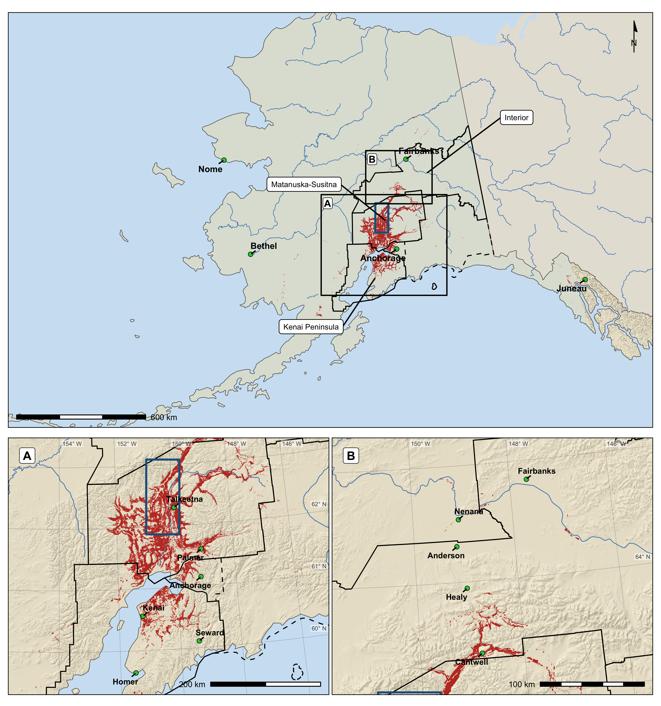
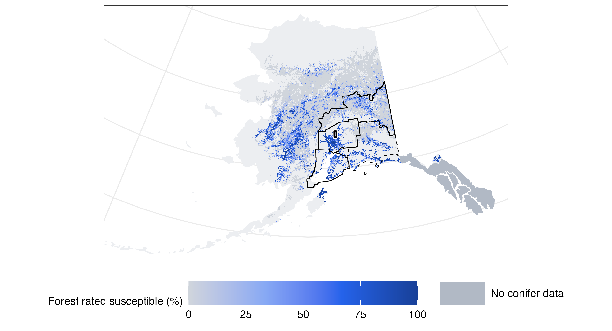
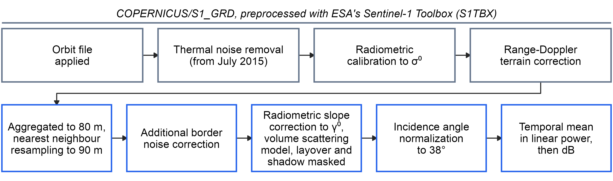

# Mapping stand susceptibility to spruce beetle outbreaks across Alaska using Sentinel-1 radar backscatter

## Abstract

In Alaska, the spruce beetle, *Dendroctonus rufipennis* (Kirby), killed the large, dominant spruce of a stand first. The United States Forest Service rated a stand’s hazard, its susceptibility to attack, from the tree diameter, basal area and spruce proportion measured in its field inventories. In 2012, the agency mapped this hazard across Alaska at a resolution of 240 m. Remote sensing studies of spruce beetle outbreaks mostly mapped the damage from optical imagery. Few studies assessed stand susceptibility before an outbreak arrived, and no studies were found that assessed it using radar. Sentinel-1 C-band backscatter from October 2014 to December 2016, recorded largely before the outbreak, was used to map stand susceptibility across Alaska at 90 m. The map was validated against mortality data of spruce crowns killed in the Susitna valley by 2021 and against beetle attack mapped by the Forest Service’s annual aerial detection survey. Before the outbreak, the backscatter coefficient (σ0) was higher in stands the beetle later attacked than in unattacked stands, -7.72 against -9.08 dB. On inventory plots in the Matanuska-Susitna Borough, dead white spruce were taller than live white spruce, 14.6 against 10.4 m, suggesting the radar recorded stand height before attack. Of the stands the beetle later attacked in the Susitna valley, the map had rated 88% susceptible. In the Susitna valley and in all three survey regions, it ranked stands better than the Forest Service hazard map. The map rated 18% of Alaska’s 446 963 km² of forest susceptible, showing managers which stands not yet attacked to protect first.

## Figures

**Figure 1** The study area. Main map, Alaska in the Alaska Albers projection (EPSG:3338) over a shaded relief. Red marks the spruce beetle damage mapped by the aerial detection survey from 2016 to 2024. Solid black outlines the three regions in which the statewide map was validated, and dashed black the Copper River basin, set apart. Blue frames the validation strip of the Susitna valley, in which Zwieback et al. (2024b) mapped dead spruce crowns on a WorldView-2 image of 2 August 2021. Boxes mark the two detail panels. A, Cook Inlet, the Kenai Peninsula and the Susitna valley. B, the Interior along the Nenana River.

**Figure 2** The five steps of the study, in the order of the Methods. The reference data of 2021 trained the threshold τ, and the validation data, which did not set it, tested the prediction. The comparison data of step 5 were scored on the same cells as Hypotheses 1 and 2. Blue marks the radar, dark blue the training, green the prediction and its application, dark green the validation and grey the comparison data.

**Figure 3** Forest rated susceptible across Alaska, the share of each 1 km cell’s forest whose pre-outbreak mean VV backscatter reached the strip threshold of -8.24 dB. The share runs from grey for none to dark blue for all. Land with less than a fifth of its area in forest is pale grey, and southeast Alaska without conifer data, left unmapped, is darker grey. Solid black outlines are the three test regions, the dashed outline the Copper River basin set apart, and the black frame the validation strip.

**Figure S1.** Processing chain of each Sentinel-1 GRD scene, in the order applied, from the orbit file to the temporal mean backscatter.

## Tables

**Table 1.** The measures the study entered, the attribute of the hazard ratings each stands for, the direction expected in the stands an outbreak attacked, and the literature the expectation rests on. VV is the radar signal sent and received in vertical polarization, and HV the signal sent horizontally and received vertically. PALSAR is the Phased Array L-band Synthetic Aperture Radar, on the Advanced Land Observing Satellite (ALOS).

| Measure | Indicator | Assumption | Basis |
|---|---|---|---|
| Canopy height before the outbreak, from two surface models | Large dominant spruce | Taller | The beetle takes large, slowly growing dominants and codominants first (Massey and Wygant 1954, Werner and Holsten 1983, Hard and Holsten 1985, Doak 2004), and an outbreak left stands with smaller average and maximum heights (Veblen et al. 1991) |
| Sentinel-1 C-band VV mean backscatter before the outbreak | Stand structure and biomass | Higher | Backscatter rises with forest biomass until it saturates, C-band being much less sensitive than L-band (Dobson et al. 1992, Santoro and Cartus 2018) |
| ALOS PALSAR L-band HV mean backscatter | Stand structure and biomass | Higher | Backscatter rises with biomass to a saturation near 100 tons per hectare at L-band (Dobson et al. 1992) |
| Change in VV through the outbreak | Mortality | A difference of either sign, if the radar recorded the mortality | Radar was proposed for bark beetle damage, although detection before the crowns fade has had limited success (Hollaus and Vreugdenhil 2019, Hechtl et al. 2025) |
| Diameter and height of dead and live white spruce on inventory plots | Tree size | Dead trees larger and taller where the outbreak has run | Killed trees were larger and grew more slowly than survivors in the same stands (Werner and Holsten 1983, Hard 1985, Doak 2004) |

**Table 2.** Satellite and survey data used in the study, and how each entered the analysis. Every raster dataset was averaged into the 90 m cells of the map. VV and VH are the radar signal sent and received in vertical polarization, and sent vertically and received horizontally; HV and HH are sent horizontally and received vertically or horizontally. γ0 is terrain-corrected radar backscatter. MSI is the Multispectral Instrument of Sentinel-2. PALSAR is the Phased Array L-band Synthetic Aperture Radar on the Advanced Land Observing Satellite 2 (ALOS-2). 3DEP is the United States 3D Elevation Program, GLO-30 the Copernicus 30 m digital elevation model, and ArcticDEM the Polar Geospatial Center surface model. Sentinel-1 built the susceptibility map, and the other satellites and the survey tested it.

| Dataset | Signal or band | Orbit / path | Period | Resolution | Images | Processing | Cloud | Role |
|---|---|---|---|---|---|---|---|---|
| Sentinel-1 | C-band radar, VV (VH for the stand series) | ascending 65, descending 131 | Oct 2014 to Dec 2016 | 10 m, read at 90 m | 57 per cell, median | slope-corrected γ0, border-noise mask, scene mean | sees through cloud | the susceptibility map |
| ALOS-2 PALSAR-2 | L-band radar, HV and HH | annual mosaic | 2015 to 2016 | 25 m, read at 90 m | two yearly mosaics | γ0 mosaic | sees through cloud | radar comparison |
| Sentinel-2 MSI | optical, shortwave infrared band 12 and others | fixed swath | Jun to Aug 2016 | 10 to 20 m, read at 90 m | clear-day mean | cloud-masked, clear-day mean | clear days only | optical comparison |
| Elevation models (GLO-30, 3DEP, ArcticDEM) | surface and ground height, canopy height their difference | mosaic | 2024 build | 2 to 30 m, read at 90 m | mosaics | surface minus ground | not affected | height comparison, and the radar slope correction |
| WorldView-2 (severity map) | optical, dead-crown share | fixed swath | 2 Aug 2021 | about 0.5 m, read at 90 m | one image | crown delineation (Zwieback 2024) | clear scene | reference labels, 34 175 attacked and 6 747 unattacked cells |
| Aerial detection survey | damage mapped by eye | from an aircraft | 2016 to 2024 | mapped polygons | yearly | field survey | not affected | validation |

**Table 3.** Area under the receiver operating characteristic curve for ranking the stands the outbreak attacked above the unattacked stands, by sensor and by label. The severity map is the 90 m map of 2021 of Zwieback et al. (2024b). The survey is the aerial detection survey’s polygons of 2016 to 2024 across the rest of the Matanuska-Susitna Borough. The statewide map is the pooled, angle-corrected mean VV backscatter of every scene, and the two orbits are the single-orbit means of the same months. VV is the radar signal sent and received in vertical polarization, and HV the signal sent horizontally and received vertically. PALSAR is the Phased Array L-band Synthetic Aperture Radar 2.

| Sensor | Severity map | Matanuska-Susitna survey |
|---|---|---|
| Sentinel-1 VV, statewide map | 0.87 |  |
| Sentinel-1 VV, ascending orbit 65 | 0.87 | 0.65 |
| Sentinel-1 VV, descending orbit 131 | 0.84 | 0.63 |
| PALSAR L-band HV | 0.86 | 0.72 |

**Table 4.** Mean and standard deviation of each sensor in the 34 175 attacked and 6 747 unattacked cells of the severity map. Radar values are backscatter in decibels, and Sentinel-2 values are top-of-atmosphere reflectance and the normalized difference vegetation index (NDVI) of summer 2016. The classes were compared by the Wilcoxon rank-sum test (\* p ≤ 0.05, \*\* p ≤ 0.01, \*\*\* p ≤ 0.001, \*\*\*\* p ≤ 0.0001). VV is the radar signal sent and received in vertical polarization, and HV and HH the signal sent horizontally and received vertically or horizontally. PALSAR-2 is the Phased Array L-band Synthetic Aperture Radar 2.

| Sensor | Attacked, M (SD) | Unattacked, M (SD) |
|---|---|---|
| Sentinel-1 VV, statewide map | -7.72 (0.52)\*\*\*\* | -9.08 (1.14) |
| Sentinel-1 VV, ascending orbit 65 | -7.71 (0.58)\*\*\*\* | -9.24 (1.26) |
| Sentinel-1 VV, descending orbit 131 | -7.76 (0.59)\*\*\*\* | -8.92 (1.11) |
| PALSAR-2 L-band HV | -12.83 (1.43)\*\*\*\* | -16.80 (3.27) |
| PALSAR-2 L-band HH | -7.54 (1.14)\*\*\*\* | -9.72 (2.20) |
| Sentinel-2 red | 0.043 (0.007)\*\*\*\* | 0.061 (0.012) |
| Sentinel-2 NDVI | 0.704 (0.054)\*\*\*\* | 0.609 (0.096) |

**Table 5.** Confusion matrices of the threshold map and of three models, in counts of 90 m cells. The reference is the attacked and unattacked cells of the severity map. The map was read at its threshold on every labelled cell, and each model on its five test folds at a fitted probability of 0.5. UA is the user’s accuracy and PA the producer’s accuracy.

|  | Reference |  |  |  |  |
|---|---|---|---|---|---|
|  |  |  | Attacked | Unattacked | UA (%) |
| Threshold map | Detection | Susceptible | 30 219 | 1 488 | 95.3 |
|  |  | Not susceptible | 3 956 | 5 259 | 57.1 |
|  |  | PA (%) | 88.4 | 77.9 |  |
| Random forest | Detection | Susceptible | 32 924 | 2 865 | 92.0 |
|  |  | Not susceptible | 1 251 | 3 882 | 75.6 |
|  |  | PA (%) | 96.3 | 57.5 |  |
| Support vector machine | Detection | Susceptible | 33 195 | 3 391 | 90.7 |
|  |  | Not susceptible | 980 | 3 356 | 77.4 |
|  |  | PA (%) | 97.1 | 49.7 |  |
| Gradient boosting | Detection | Susceptible | 32 972 | 2 889 | 91.9 |
|  |  | Not susceptible | 1 203 | 3 858 | 76.2 |
|  |  | PA (%) | 96.5 | 57.2 |  |

**Table 6.** Separability, accuracy and fit of each sensor against the attacked and unattacked cells of the severity map. M is the separability index, the difference of the class means over the sum of their standard deviations. AUC is the area under the receiver operating characteristic curve. Overall accuracy was read at each sensor’s own Youden threshold. R² is Nagelkerke’s, RMSE the root mean square error and MAE the mean absolute error of a logistic regression of the class on the sensor, and Moran’s I is the spatial autocorrelation of its residuals. VV is the radar signal sent and received in vertical polarization, and HV and HH the signal sent horizontally and received vertically or horizontally. PALSAR-2 is the Phased Array L-band Synthetic Aperture Radar 2, and NDVI the normalized difference vegetation index.

| Sensor | M | AUC | Overall accuracy (%) | R² | RMSE | MAE | Moran's I |
|---|---|---|---|---|---|---|---|
| Sentinel-1 VV, statewide map | 0.82 | 0.87 | 87 | 0.48 | 0.27 | 0.16 | 0.43 |
| Sentinel-1 VV, ascending orbit 65 | 0.83 | 0.87 | 87 | 0.50 | 0.27 | 0.15 | 0.43 |
| Sentinel-1 VV, descending orbit 131 | 0.68 | 0.84 | 86 | 0.37 | 0.30 | 0.18 | 0.43 |
| PALSAR-2 L-band HV | 0.84 | 0.86 | 86 | 0.46 | 0.28 | 0.16 | 0.35 |
| PALSAR-2 L-band HH | 0.65 | 0.82 | 86 |  |  |  |  |
| Sentinel-2 red | 0.95 | 0.91 | 85 |  |  |  |  |
| Sentinel-2 NDVI | 0.64 | 0.88 | 77 |  |  |  |  |

**Table 7.** Diagnostics of five models of the attacked and unattacked cells of the severity map. Model performance was assessed by the full root mean square error (RMSE) of the model fitted to every cell, the cross-validated RMSE, the overfitting ratio (RMSE ratio, cross-validated over full), the systematic bias (Theil’s U bias), the mean absolute error (MAE), and the overall accuracy (OA) with the producer’s accuracy (PA) of each class at a fitted probability of 0.5.

| Model | Hyperparameters | Full RMSE | Cross-validated RMSE | RMSE ratio | Theil's U bias | MAE | OA (%) | PA, attacked (%) | PA, unattacked (%) |
|---|---|---|---|---|---|---|---|---|---|
| Logistic regression | None | 0.275 | 0.280 | 1.02 | 0.0003 | 0.166 | 89.1 | 97.2 | 48.1 |
| Random forest | Minimum node size 1000, 2 predictors a split | 0.259 | 0.273 | 1.05 | 0.0005 | 0.150 | 89.9 | 96.3 | 57.5 |
| Support vector machine | Cost 1, gamma 0.01 | 0.272 | 0.278 | 1.02 | 0.0001 | 0.160 | 89.3 | 97.1 | 49.7 |
| Gradient boosting | Depth 4, learning rate 0.05, 200 trees | 0.261 | 0.273 | 1.05 | 0.0005 | 0.149 | 90.0 | 96.5 | 57.2 |
| Random forest, untuned | Minimum node size 1, 1 predictor a split | 0.104 | 0.289 | 2.78 | 0.0006 | 0.148 | 89.2 | 95.8 | 55.5 |

**Table 8.** Forest and susceptible forest in the three survey regions and in Alaska, summed at 1 km from the 90 m map. Forest is the area of 30 m cells with a conifer top cover of 5% or more in 2015, or of a LANDFIRE spruce type where that layer held no data west of 141° W. Susceptible forest is the forest of the 90 m cells whose pre-outbreak mean VV backscatter reached -8.24 dB, the threshold that best separated the attacked from the unattacked cells of the severity map. Scenes is the median number of Sentinel-1 scenes behind a forest cell. VV is the radar signal sent and received in vertical polarization. LANDFIRE is an interagency wildland fire data programme of the United States.

| Region | Forest (km²) | Susceptible (km²) | Susceptible (%) | Scenes |
|---|---|---|---|---|
| Kenai Peninsula | 9 347 | 5 603 | 60 | 49 |
| Matanuska-Susitna | 17 750 | 8 381 | 47 | 57 |
| Interior | 70 639 | 10 105 | 14 | 69 |
| Alaska | 446 963 | 81 945 | 18 | 55 |

**Table 9.** The statewide map against the aerial detection survey in three regions. Attacked cells lay inside a spruce beetle polygon on white spruce of 2016 to 2024; unattacked cells were forest the surveyors flew over, never inside a spruce beetle polygon of any year, within 10 km of one. AUC is the area under the curve for ranking attacked above unattacked; the two shares are the cells of each class the strip’s VV threshold called susceptible. VV is the radar signal sent and received in vertical polarization.

| Region | Attacked | Unattacked | AUC, VV | VV attacked (dB) | VV unattacked (dB) | Susceptible attacked (%) | Susceptible unattacked (%) |
|---|---|---|---|---|---|---|---|
| Kenai Peninsula | 4 998 | 4 900 | 0.71 | -7.9 | -8.4 | 79 | 47 |
| Matanuska-Susitna | 5 000 | 4 995 | 0.72 | -7.8 | -8.7 | 75 | 40 |
| Interior | 5 000 | 4 147 | 0.60 | -8.7 | -9.0 | 30 | 19 |

**Table S1.** Survey coverage and scores of the three survey regions and of the Copper River basin. The basin was set apart from the test of the second hypothesis, because the survey flew over its cells in one or two of the nine years from 2016 to 2024. Years flown is the median count over the sampled cells of each class. AUC is the area under the curve for ranking attacked above unattacked, with Sentinel-2 red scored on the cells with a clear day. VV is the radar signal sent and received in vertical polarization.

| Region | Attacked | Unattacked | Years flown, attacked | Years flown, unattacked | AUC, VV | AUC, red | AUC, hazard map |
|---|---|---|---|---|---|---|---|
| Kenai Peninsula | 4 998 | 4 900 | 4 | 4 | 0.71 | 0.51 | 0.58 |
| Matanuska-Susitna Borough | 5 000 | 4 995 | 4 | 3 | 0.72 | 0.62 | 0.66 |
| Interior | 5 000 | 4 147 | 4 | 4 | 0.60 | 0.65 | 0.52 |
| Copper River basin, set apart | 2 323 | 4 999 | 1 | 2 | 0.37 | 0.52 | 0.37 |

**Table S2.** Fit and overfitting diagnostics of the logistic fits of the attacked and unattacked cells of the severity map, and of the temporal network on the crown labels. R² is Nagelkerke’s, starred by the likelihood ratio test against the null fit, and Hosmer-Lemeshow is the statistic over ten groups, starred by its test. Brier is the mean squared error of the fitted probability against the label, and RMSE is its root. The relative error, rRMSE, is that root over the mean of the label, in per cent, and MAE is the mean absolute error. The RMSE ratio is the cross-validated RMSE over the full RMSE, and for the network the RMSE of the held-out folds over that of the training folds. Above 1.1 a fit is overfitted (Valbuena et al. 2017; Murphy et al. 2026). Theil’s U bias is the share of the held-out mean squared error due to the difference between the mean prediction and the mean label. Moran’s I measures the clustering of the residuals over the eight nearest labelled cells, starred by its test. Durbin-Watson is the statistic of the residuals in cell order. VV is the radar signal sent and received in vertical polarization, and HV and HH the signal sent horizontally and received vertically or horizontally. PALSAR is the Phased Array L-band Synthetic Aperture Radar 2. \* p ≤ 0.05, \*\* p ≤ 0.01, \*\*\* p ≤ 0.001, \*\*\*\* p ≤ 0.0001.

| Model | n | R² | Hosmer-Lemeshow | Brier | RMSE | rRMSE (%) | MAE | RMSE ratio | Theil's U bias | Moran's I | Durbin-Watson |
|---|---|---|---|---|---|---|---|---|---|---|---|
| Sentinel-1 VV, statewide product | 40 922 | 0.477\*\*\*\* | 1144\*\*\*\* | 0.076 | 0.275 | 32.9 | 0.157 | 1.02 | 0.000 | 0.430\*\*\*\* | 1.26 |
| Sentinel-1 VV, ascending orbit 65 | 40 922 | 0.498\*\*\*\* | 1038\*\*\*\* | 0.073 | 0.270 | 32.3 | 0.151 | 1.02 | 0.000 | 0.429\*\*\*\* | 1.24 |
| Sentinel-1 VV, descending orbit 131 | 40 922 | 0.373\*\*\*\* | 1240\*\*\*\* | 0.090 | 0.299 | 35.8 | 0.185 | 1.01 | 0.000 | 0.428\*\*\*\* | 1.31 |
| GLO-30 surface minus terrain | 40 922 | 0.294\*\*\*\* | 3543\*\*\*\* | 0.101 | 0.318 | 38.0 | 0.211 | 1.04 | 0.000 | 0.519\*\*\*\* | 1.09 |
| PALSAR L-band HV | 40 922 | 0.464\*\*\*\* | 368\*\*\*\* | 0.081 | 0.285 | 34.1 | 0.163 | 1.00 | 0.000 | 0.355\*\*\*\* | 1.38 |
| Two C-band orbits | 40 922 | 0.498\*\*\*\* | 1047\*\*\*\* | 0.073 | 0.270 | 32.3 | 0.151 | 1.02 | 0.000 | 0.429\*\*\*\* | 1.24 |
| L-band HV and HH | 40 922 | 0.474\*\*\*\* | 272\*\*\*\* | 0.081 | 0.284 | 34.0 | 0.161 | 1.00 | 0.000 | 0.336\*\*\*\* | 1.42 |
| C-band and height | 40 922 | 0.515\*\*\*\* | 1339\*\*\*\* | 0.070 | 0.265 | 31.7 | 0.147 | 1.02 | 0.000 | 0.434\*\*\*\* | 1.24 |
| L-band and height | 40 922 | 0.501\*\*\*\* | 1177\*\*\*\* | 0.075 | 0.273 | 32.7 | 0.153 | 1.00 | 0.000 | 0.342\*\*\*\* | 1.41 |
| All five sources | 40 922 | 0.556\*\*\*\* | 662\*\*\*\* | 0.067 | 0.259 | 31.0 | 0.138 | 1.01 | 0.000 | 0.368\*\*\*\* | 1.34 |
| Temp network, blind crown folds | 510 |  |  | 0.092 | 0.303 | 41.9 | 0.138 | 2.13 | 0.012 | 0.269\*\*\*\* | 1.35 |

**Table S3.** Data, dates, operation and output of each step of the study. The reference data of step 2 set the threshold and tested the first hypothesis, and the validation data of step 4 tested the map without setting it. VV is the radar signal sent and received in vertical polarization, and HV and HH the signal sent horizontally and received vertically or horizontally. PALSAR-2 is the Phased Array L-band Synthetic Aperture Radar 2, and NDVI the normalized difference vegetation index. M is the separability index of Kaufman and Remer (1994). LANDFIRE is an interagency wildland fire data programme of the United States, and dB is the decibel.

| Step | Data | Dates | Operation | Output |
|---|---|---|---|---|
| 1. Mean backscatter | Sentinel-1 C-band VV backscatter, every interferometric wide swath scene over Alaska | October 2014 to December 2016 | Border noise masked, slope corrected, normalized to 38° incidence, aggregated to 90 m, averaged in linear power | Mean backscatter of every 90 m forest cell of Alaska |
| 2. Training | Reference data, the severity map of Zwieback et al. (2024), 34 175 attacked and 6 747 unattacked cells of 90 m | WorldView-2 image of 2 August 2021 | Attacked ranked against unattacked cells by the area under the receiver operating characteristic curve and separated by M; threshold set by Youden's index; spatial 5-fold cross-validation of four tuned models; 1 000 draws of 5 000 cells of each class | Test of the first hypothesis; threshold of -8.24 dB, with overall accuracy, kappa and commission and omission errors |
| 3. Prediction | Mean backscatter; conifer top cover of 5% or more, or a LANDFIRE spruce type where it held no data west of 141° W | October 2014 to December 2016; 2015 | Forest cells at or above the threshold rated susceptible | Susceptibility map of Alaska; susceptible forest by region and outside the outbreak |
| 4. Validation | Validation data, the aerial detection survey in three regions, the Copper River basin set apart, and 708 inventory plots with white spruce in the same regions | 2016 to 2024; plots measured 1999 to 2025 | Area under the curve and area-weighted accuracy; paired Wilcoxon signed-rank test of dead against live white spruce | Test of the second hypothesis |
| 5. Comparison | PALSAR-2 L-band HV and HH; change in Sentinel-1 VV; Sentinel-2 red, band 12 and NDVI; Forest Service hazard map | 2015 and 2016; October 2014 to December 2016 against June 2019 to August 2021; summer 2016, with 2015 for clear days; 2012 | Scored as the mean backscatter, on the same cells | Benchmarks of the mean backscatter |

**Table S4.** Separability and classification accuracy of each source at its own Youden threshold against the attacked and unattacked cells of the severity map. M is the separability index of Kaufman and Remer (1994), the difference of the class means over the sum of their standard deviations, starred by the Wilcoxon rank-sum test. AUC is the area under the receiver operating characteristic curve, with the 95% confidence interval (CI) of DeLong et al. (1988). The threshold is in the source’s own unit, decibels for radar and reflectance for red, which was darker over attacked cells. For the normalized difference vegetation index (NDVI) of the clear days of 23 June to 31 August 2016, it is the index itself. Kappa is Cohen’s kappa, and the overall accuracy carries its exact binomial 95% CI. VV is the radar signal sent and received in vertical polarization, and HV and HH the signal sent horizontally and received vertically or horizontally. PALSAR is the Phased Array L-band Synthetic Aperture Radar 2. \* p ≤ 0.05, \*\* p ≤ 0.01, \*\*\* p ≤ 0.001, \*\*\*\* p ≤ 0.0001.

| Source | Attacked cells | Unattacked cells | M | AUC (95% CI) | Threshold | Kappa | Commission, attacked | Commission, unattacked | Omission, attacked | Omission, unattacked | Overall accuracy (95% CI) |
|---|---|---|---|---|---|---|---|---|---|---|---|
| Sentinel-1 VV, statewide product | 34 175 | 6 747 | 0.82\*\*\*\* | 0.87 (0.86, 0.87) | -8.24 | 0.58 | 0.05 | 0.43 | 0.12 | 0.22 | 0.87 (0.86, 0.87) |
| Sentinel-1 VV, ascending orbit 65 | 34 990 | 6 774 | 0.83\*\*\*\* | 0.87 (0.87, 0.88) | -8.32 | 0.59 | 0.05 | 0.41 | 0.11 | 0.22 | 0.87 (0.87, 0.88) |
| Sentinel-1 VV, descending orbit 131 | 34 990 | 6 774 | 0.68\*\*\*\* | 0.84 (0.83, 0.84) | -8.34 | 0.53 | 0.06 | 0.45 | 0.11 | 0.29 | 0.86 (0.85, 0.86) |
| PALSAR L-band HV | 34 990 | 6 774 | 0.84\*\*\*\* | 0.86 (0.86, 0.87) | -14.08 | 0.56 | 0.05 | 0.44 | 0.11 | 0.25 | 0.86 (0.86, 0.87) |
| PALSAR L-band HH | 34 990 | 6 774 | 0.65\*\*\*\* | 0.82 (0.81, 0.83) | -8.68 | 0.53 | 0.06 | 0.45 | 0.11 | 0.32 | 0.86 (0.86, 0.86) |
| Sentinel-2 red summer 2016 | 34 175 | 6 747 | 0.95\*\*\*\* | 0.91 (0.90, 0.91) | 0.05 | 0.55 | 0.04 | 0.48 | 0.15 | 0.17 | 0.85 (0.84, 0.85) |
| Sentinel-2 NDVI summer 2016 | 34 175 | 6 747 | 0.64\*\*\*\* | 0.88 (0.87, 0.88) | 0.68 | 0.42 | 0.04 | 0.59 | 0.24 | 0.16 | 0.77 (0.77, 0.78) |
